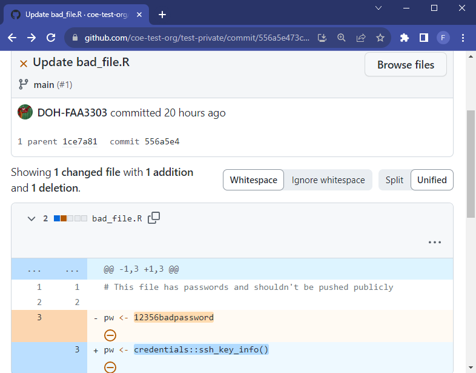
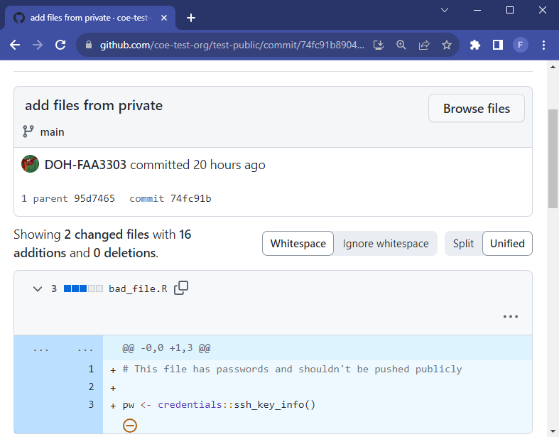
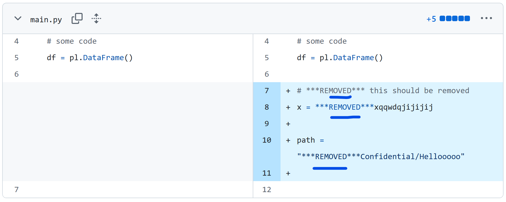

# Repo Security

Protect your credentials, tokens, data and more

Authors

Frank Aragona

Kathleen Conery

Published

Sunday, the 9th of April, 2023

Modified

Tuesday, the 24th of November, 2026

## Objectives

- Prevent sensitive information leaks to Github
- Set up guardrails, `.gitignore`, hooks
- Scrub private repos before they go public

If sensitive information is leaked and commited to the remote repo, then they will stay in the git history (and will require a lot of effort to remove them from the history).

> **CAUTION:**
>
> Err on the side of caution: If data isn’t already public, it likely shouldn’t be made public through a PR or a commit.

The following cannot be included in any repo **or any local commit!**:

[TABLE]

Table 1: Items prohibited from being in a Github repo

If you have any prohibited item in your remove, remove it from the git history [Section 8](#sec-history) or consider creating a new repo.

## Protect Credentials with .gitignore

It is bad practice and a security risk to add private credentials to a script. If your script contains things like passwords, server names, or network drives, be aware that that information will be publicly visible when you push it to a remote git/github repo. Many of our scripts must call passwords and server names in order for them to work properly, so we need a way to hide that information from the public but still be able to run the scripts locally. `.gitignore` can help achieve this.

In the root of your repo there should be a file called `.gitignore`. This files contains a list of file types that we don’t want to be added to the remote git repo. Here’s an example:

consider this `.gitignore`:

    # excel files
    *.xlsx
    *.xls

    # logs
    *.log

    # text files
    *.txt

    # RDS Objects
    *.RDS

It contains anything with an excel, log, txt or RDS extension. This means that any file with those extensions that you create in your local clone of the repo will exist for you, but the file cannot and will not ever be pushed to the remote repo.

### Environment Variables + .gitignore

We can store private information in local files and make sure that the do not get pushed to the public remote repo by using `.gitignore`. There are a number of ways to do this. We typically use a yaml file that can be filled out with personal credentials locally. The file will not be committed to the remote repo.

There are many ways to achieve this. If you have a more simple workflow that uses R, consider the `.Renviron` approach. If you have a more complex workflow that has multiple languages and many credentials, consider the `yaml` approach

## .Renviron

If you’re using just R in your repo and have just a few things you want private, consider using a `.Renviron` file in addition to `.gitignore`.

1.  In the `.gitignore`, add `.Renviron`:

        # R Environment Variables
        .Renviron

2.  Create a `.Renviron` file at the root of you local repo

3.  Add the things you want to be kept private

        my_password="thisismypassword123"

4.  Now in an R script you can call that password *and* hide the credentials instead of writting the password in the script for everyone to see:

``` r
my_password <- Sys.getenv('my_password')
```

``` r
my_password <- "thisismypassword123"
```

`Sys.getenv()` looks for the `.Renviron` file and the variables inside of it. This means you can get all your credentials from the `.Renviron` but also keep that information

## yaml

Here’s another way to add credentials that may be more robust.

Many of our scripts use a `.yml` file that contains a list of API tokens, server names, and usernames/passwords specific to each individual user. There are two `.yml` files. One is a template (containing no actual passwords..) that exists in the repo and serves as a template so every individual user can keep up to date with new credential additions. The other is the individual `creds.yml` that is in the repo’s `.gitignore`. This file will never exist in the repo and only exist locally (in the user’s C drive).

The `.yml` file can work with multiple programming languages including R and Python. They are read in the same way and can be easily adjusted when adding new passwords or using them as configuration files. It can work like this:

1.  In your `.gitignore`, add a new line that says `creds.yml`.

``` markdown
# creds files
creds.yml
```

2.  In the root of you local git clone, make a file called `creds.yml`.

3.  In the yaml file you can nest values. For example, under `conn_list_wdrs` I have all the parameters needed to make a SQL server connection string in R/Python:

``` yaml
# Default is needed to distinguish values.
# Leave a blank line (NO SPACES) as the last line in this file or things will break
# Quotes aren't necessary, but can be used.
default: 
  conn_list_wdrs:
    Driver: "SQL Server Native Client 11.0"
    Server: "someservername"
    Database: "db"
    Trusted_connection: "yes" 
    ApplicationIntent: "readonly"
    
  fulgent:
    username: <USERNAME>
    password: <PASSWORD>
```

4.  To call these credentials in R or Python it will look like this:

``` r
library(yaml)

# read in the local credentials yaml file
creds <- yaml::read_yaml("creds.yml")$default

# call in the variables

connection <- DBI::dbConnect(
  odbc::odbc(), 
  Driver = creds$conn_list_wdrs$Driver, 
  Server = creds$conn_list_wdrs$Server, 
  Database = creds$conn_list_wdrs$Database, 
  Trusted_connection = creds$conn_list_wdrs$Trusted_connection, 
  ApplicationIntent = creds$conn_list_wdrs$ApplicationIntent
)
```

``` python
import yaml

# read credentials
with open(f"creds.yml") as f:
    creds = yaml.safe_load(f)['default']

conn = pyodbc.connect(
  DRIVER=creds['conn_list_wdrs']['Driver'],
  SERVER=creds['conn_list_wdrs']['Server'],
  DATABASE=creds['conn_list_wdrs']['Database'],
  Trusted_Connection=creds['conn_list_wdrs']['Trusted_connection'],
  ApplicationIntent=creds['conn_list_wdrs']['ApplicationIntent']
  )
```

5.  You can add more nested sections besides default, like this, where I added a `test` parameter:

``` yaml
# Default is needed to distinguish values.
# Leave a blank line (NO SPACES) as the last line in this file or things will break
# Quotes aren't necessary, but can be used.
default: 
  conn_list_wdrs:
    Driver: "SQL Server Native Client 11.0"
    Server: "someservername"
    Database: "db"
    Trusted_connection: "yes" 
    ApplicationIntent: "readonly"
    
  fulgent:
    username: <USERNAME>
    password: <PASSWORD>

test:
  conn_list_wdrs:
    Driver: "SQL Server Native Client 11.0"
    Server: 
    Database: 
    Trusted_connection: 
    ApplicationIntent: 
```

This is useful to organized and automatically call different parameters. Now there is a `test` list with its own variables. This lets us switch a set of variables within our scripts. `default` applies to the main credentials where `test` can distinguish which variables should be test or dev scripts specific. Notice below that you can now call the credentials from a `.yml` file into an R or Python script and the actual credentials will never exist in the code pushed to the repo.

``` r
# this script is in the repo, but credentials are hidden
library(yaml)

# read in the local credentials yaml file
creds <- yaml::read_yaml("path/to/local-credentials.yml")

# pull in the credentials
server_name <- creds$default$conn_list_wdrs$server
```

##### Automating With Yaml Creds

We can even get more specific and add an `if-else` statement to specify which credential we want to select. This can be helpful if we have a CI/CD pipeline and have a script automatically run on a task scheduler or cron job. We can call the credentials we want in the command line and have the command line code run in my task scheduler. That way we can use multiple different versions of the same script and have all of it be automated.

For example,

- the R script on the left uses the `commandArgs()` to pull any arguments passed to the script in a shell/command line script.
- on the right, the shell script has `production` and `test` as second arguments.
- these are passed to the R script as `arg[2]`.
- now we can use `arg[2]` in the if-else statement to conditionally select credentials and do it automatically in a pipeline.

``` r
args <- commandArgs(TRUE)

# this script is in the repo, but credentials are hidden
library(yaml)

# read in the local credentials yaml file
creds <- yaml::read_yaml("path/to/local-credentials.yml")

# pull in the credentials
if(args[2] == "production"){
  server_name <- creds$default$conn_list_wdrs$server
} else if(args[2] == "test"){
  server_name <- creds$test$conn_list_wdrs$server
}
```

``` bash
# Run the production code
$ Rscript -e "source('path/script_in_repo.R');" production

# Run the test/dev code
$ Rscript -e "source('path/script_in_repo.R');" test 
```

##### yaml Template

You can put a template creds.yml file in your repo so that others can see what credentials they need in order for the code to run.

**This is a *template* file, so it will not have any passwords/secrets in it**. Its only purpose is to provide an example copy of what a user’s `creds.yml` file needs to look like.

1.  Make a template called `creds_TEMPLATE.yml`

2.  Remove any passwords, usernames, secrets, etc to have it be a file that looks like this:

``` yaml
# Default is needed to distinguish values.
# Leave a blank line (NO SPACES) as the last line in this file or things will break
# Quotes aren't necessary, but can be used.
default: 
  conn_list_wdrs:
    Driver: 
    Server: 
    Database: 
    Trusted_connection: 
    ApplicationIntent: 
    
  fulgent:
    username: 
    password: 

test:
  conn_list_wdrs:
    Driver: 
    Server: 
    Database: 
    Trusted_connection: 
    ApplicationIntent: 
```

3.  Once you have the `creds_TEMPLATE.yml` template in your repo, make sure that nobody on your team (or anyone with write access..) is able to accidentally push changes to the template. We don’t want someone’s passwords or API tokens to exist in GitHub.

This link shows how to skip any changes made to the specific file https://stackoverflow.com/a/39776107. If someone makes local changes to the template, the changes will not show in their commit. It is a safe guard.

4.  For all individual users, run this code:

    ``` bash
    git update-index --skip-worktree creds_TEMPLATE.yml
    ```

This will tell your local git to ignore any changes made to `creds_TEMPLATE.yml`, but also allow it to exist in the repo (since `.gitignore` will prevent it from being in the repo)

5.  If you need to update the template file run this:

    ``` bash
    git update-index --no-skip-worktree creds_TEMPLATE.yml
    ```

This will allow changes to the template. **So when you need to update the template, use this code**

And to get a list of files that are “skipped”, use this code:

``` bash
git ls-files -v . | grep ^S
```

\

\

## Security Guardrails

Using a `.gitignore` file for environmental variables/credentials is an excellent guardrail and promotes good coding habits, but we may also want additional guardrails such as hooks.

Hooks are processes that run in the background and can prevent code from being pushed if there is a security flaw. There are two hooks we could use for security; pre-commit hooks and pre-receive hooks

## Pre-commit Hooks

Pre-commit hooks run a process locally when the user attempts to commit code to a git branch. Hooks have many uses. Here we can use them as a security guardrail to prevent accidental credential leaks in committed code. For example, if someone accidentally pushes a server name to the public repo, the hook will prevent that code from ever getting into the remote repo and will give the user a local error.

### For Washington DOH Users:

Please reach out to our email \[<DOH.CDS.GenSeqSurvDQ@doh.wa.gov>\] for access to our automated pre-commit hooks. We require this for all users in our org.

### For Devs, creating hooks for your team:

Our teams use custom hooks that let us share a ‘ban list’. A ban list is a .txt file that has regex or strings that are prohibited from being in our repos. The base code uses a program called [git-find](https://github.com/edenian-prince/rust-secrets).

1.  Create a new repo with the following files; `setup.ps1`, `setup.sh`, and `patterns.txt`

The setup scripts will contain code for installing the git-find program.

2.  Paste this code in the setup files:

## setup.ps1

``` powershell
# -------------------------------------------------
# Fail-Fast Automated Setup Script
# -------------------------------------------------

# Stop immediately if any command fails
$ErrorActionPreference = "Stop"

try {

    # Define variables
    $cliURL = "https://github.com/edenian-prince/rust-secrets.git"  # <-- path to the cli tool. don't touch!
    $cliPathName = "rust-secrets"
    $cliPath = Join-Path $HOME $cliPathName

    $RepoUrl = ""                                                   # <-- replace with your repo URL
    $RepoName = "secret-hooks"                                      # <-- folder name to clone into
    $RepoFile = "patterns.txt"
    $RepoPath = Join-Path $HOME $RepoName
    $SecretFilePath = Join-Path $RepoPath $RepoFile

    # 1️ Install CLI tool
    Write-Host "Cloning repository to $cliPath..."
    if (Test-Path $cliPath) {
        Write-Host "Repository folder already exists. Pulling latest changes..."
        Set-Location $cliPath
        git pull
        powershell -ExecutionPolicy Bypass -File ./install.ps1
    } else {
        git clone $cliURL $cliPath
        Set-Location $cliPath
        powershell -ExecutionPolicy Bypass -File ./install.ps1

    }

    # 3️ Clone the repo to $HOME
    Write-Host "Cloning repository to $RepoPath..."
    if (Test-Path $RepoPath) {
        Write-Host "Repository folder already exists. Pulling latest changes..."
        Set-Location $RepoPath
        git pull
    } else {
        git clone $RepoUrl $RepoPath
    }

    # 4️ Run git-find install
    Write-Host "Running git-find install..."
    git-find install

    # 5️ Run git-find add-provider and automatically answer 'y'
    # Write 'y' to stdin.txt first
    "y" | Set-Content -Path "stdin.txt"
    
    # Then start the process
    Write-Host "Running git-find add-provider $SecretFilePath..."
    $proc = Start-Process -FilePath "git-find" `
        -ArgumentList "add-provider", "--path", $SecretFilePath `
        -NoNewWindow -RedirectStandardInput "stdin.txt" -Wait -PassThru
    
    $proc.WaitForExit()

    # Clean up repo
    # Move out of repo directory before deleting it
    Set-Location ..

    # Remove the repo directory
    Write-Host "Clean up, removing folder: $cliPath"
    Remove-Item -Recurse -Force $cliPath

    Write-Host "✅ Setup completed successfully!"

} catch {
    Write-Host "ERROR: Script stopped. $_" -ForegroundColor Red
    exit 1
}
```

## setup.sh

``` bash
#!/usr/bin/env bash

# -------------------------------------------------
# Fail-Fast Automated Setup Script (Bash/Linux)
# -------------------------------------------------

set -e  # Exit immediately if a command fails
set -o pipefail  # Catch errors in piped commands

# Helper function for error handling
function handle_error {
    echo "ERROR: Script stopped at line $1."
    exit 1
}
trap 'handle_error $LINENO' ERR

# ------------------------------
# 1️ Install CLI tool
# ------------------------------
CLI_URL="https://github.com/edenian-prince/rust-secrets.git"  # <-- don't touch! this is where the cli tool lives
CLI_NAME="rust-secrets"
CLI_PATH="$HOME/$CLI_NAME"

REPO_URL=""                                                   # <-- replace with your repo URL
REPO_NAME="secret-hooks"
REPO_FILE="patterns.txt"
REPO_PATH="$HOME/$REPO_NAME"
SECRET_FILE_PATH="$REPO_PATH/$REPO_FILE"

echo "Cloning repository to $CLI_PATH..."
if [ -d "$CLI_PATH" ]; then
    echo "Repository folder already exists. Pulling latest changes..."
    cd "$CLI_PATH"
    git pull
else
    git clone "$CLI_URL" "$CLI_PATH"
    cd "$CLI_PATH"
fi

# Run install script (assuming Bash version of install exists)
if [ -f "./install.sh" ]; then
    bash ./install.sh
elif [ -f "./install.ps1" ]; then
    # If only PowerShell script exists
    pwsh -File ./install.ps1
else
    echo "No install script found in $CLI_PATH"
fi

# ------------------------------
# 2️ Clone secrets repo
# ------------------------------

echo "Cloning repository to $REPO_PATH..."
if [ -d "$REPO_PATH" ]; then
    echo "Repository folder already exists. Pulling latest changes..."
    cd "$REPO_PATH"
    git pull
else
    git clone "$REPO_URL" "$REPO_PATH"
    cd "$REPO_PATH"
fi

# ------------------------------
# 3️ Run git-find install
# ------------------------------
echo "Running git-find install..."
git-find install

# ------------------------------
# 4️ Run git-find add-provider and automatically answer 'y'
# ------------------------------
echo "y" | git-find add-provider --path "$SECRET_FILE_PATH"

# ------------------------------
# 5️ Clean up CLI repo
# ------------------------------
echo "Clean up, removing folder: $CLI_PATH"
rm -rf "$CLI_PATH"

echo "✅ Setup completed successfully!"
```

3.  In the `patterns.txt` file, put the strings and regexes that you want to avoid in the file on separate lines like:

``` default
# Place your regex patterns here
# Don't paste actual secrets!! Regular expressions only

# Azure tokens - this regex didn't work for me.. broken
[A-Za-z0-9_-]+\.[A-Za-z0-9_-]+\.[A-Za-z0-9_-]+

# Generic private key
-----BEGIN [A-Z]*PRIVATE KEY-----

# Databricks tokens
dapi[0-9a-fA-F]{32,64}

# Databricks url
adb-[0-9]{16}
```

4.  Now, your users can clone the repo, open up powershell or bash, and run:

``` powershell
./setup.ps1
```

or

``` bash
chmod +x setup.sh
./setup.sh
```

5.  If you ever need to update the ban list/`patterns.txt` it will automatically update the list for all of your users that have the program installed.

\

\

> **IMPORTANT:**
>
> - The REGEX strings used in the `secrets_key` file may be decieving
> - Make sure to test that the regex flags what you want it to
> - You can also add personal regexes and local ban lists on a per repo basis
> - See [https://github.com/edenian-prince/rust-secrets/](https://github.com/edenian-prince/rust-secrets/tree/main#rust-secrets) for more details and examples!

## Secret Scanning

Now that the pre-commit hook is set up, any future commits to your repo will be scanned for secrets. If you are pushing a pre-existing repo to a public repo for the first time, you should scan the existing code in the repo because the pre-commit hook will not automatically do that. They are really set up to prevent any *future* secrets from being pushed to the repo, not to scan what is *currently* in the repo.

I’ll show 2 ways to scan for secrets, one with a native git command `git log`, and the other with `git find`

### git find for scanning

You can use the `git-find` command that you installed in the pre-commit hooks to scan your repos for every item in the `patterns.txt` or ban list.

1.  Navigate to your repo and run:

``` bash
git find scan
```

and it will look like this, indicating which regexes passed or failed:

``` bash
Local file: C:\Users\FAA3303\pathogen-repo-guide-secrets.txt
Loaded 2 regexes
Scanning for regex: -----BEGIN [A-Z]*PRIVATE KEY-----
No matches found for pattern #1

Scanning for regex: dapi[0-9a-fA-F]{32,64}
No matches found for pattern #2

Scanning for regex: adb-[0-9]{16}
No matches found for pattern #3
```

### git log for scanning

Here’s a base git way to scan *commit history*.

Navigate to your repo and execute this command:

``` bash
git log -G"<regex here>" -p
```

Note that the regex pattern can be imported from the `secrets_key` file. You can also search for simple strings like this

``` bash
git log -S "<string>" -p
```

There are a lot of options with the `git log` command and you can [read more here](https://git-scm.com/docs/git-log#Documentation/git-log.txt--Sltstringgt) and [here](https://stackoverflow.com/questions/4468361/search-all-of-git-history-for-a-string)

Basically, the `-G` option stands for `grep`, `-p` will show the diffs of the files, and `-S` is for string.

## Pre-Recieve Hooks

These are remote hooks (not local like pre-commit hooks) that can be deployed throughout the Github organization. They can block certain commits from ever being pushed to the remote repo. They may make things unnecessarily complicated but they cost money. Go to your GitHub admins and see if they can activate them in your org.

## Pushing Private Code to Public Repos

We may wish to take private codes and push them to a public repo. We need to make sure that the public code doesn’t not contain sensitive or forbidden data/code, so cleaning up the private repo is important before pushing.

There are a few ways to do this, but the easiest way is to copy the clean private code to the public repo, that is, copy all the files you want to add publicly but **do not copy the `.git`** folder. If the private repo has a dirty git history we will not want that history in the public repo because the sensitive data will then be publicly available.





> **WARNING:**
>
> The private repository on the left still contains sensitive information in the git history. The public repository on the right has a clean git history because we copied only the current clean files from the private repo and did not attach its git history (which lives in the hidden `.git` folder)

## Clean git history

If you have a repo that has secrets or prohibited values in any commit, you can remove them from the git history. If you have a private repo that needs to be made public and it contains bad commits in the history, consider creating a new repo for the public version. If that is not doable, here are steps for removing the prohibited secrets from the git history.

> **WARNING:**
>
> This is kinda skecthy and irreversible. It involves changing the git history from a local machine. The local clone can destroy code in your repo if it is behind or ahead in commits relative to the main branch in the remote repo. Consider setting up a test repo and practice on it before doing anything. And always make a backup of your work. See Frank or DIQA people for help.

1.  Install the [git-filter-repo](https://github.com/newren/git-filter-repo/tree/main#how-do-i-install-it) tool for cleaning the git history. Click that link for instructions, it involves cloning the repo and then putting the folder path in your PATH
2.  In a terminal, navigate to your repo and run

``` bash
git filter-repo --analyze
```

3.  Now clean the history with:

``` bash
git filter-repo --replace-text C:\path\to\secrets\patterns.txt
```

Note, you can write a string or a .txt path to that command above and it will remove any string in your git history with those patterns. Since we have patterns already specified from our git secrets tool, use that file here.

4.  Check your local clone and see if it properly redacted the files

5.  Add the remote back to your clone

By default, these commands remove the link between github and your local folder containing the code (for a good reason). You’ll need to create the link again with:

``` bash
git remote add origin <repository-url>
```

6.  Push the new git history to main/your repo. Must be done by an admin. **Please be careful with this**.

``` bash
git push origin main --force
```

if that doesn’t work try

``` bash
git push --force --all origin
```

It should look like this in GitHub now where strings are replaced with `REMOVED`



There are many more options for overwriting the git history, such as removing a file instead of just key words. See the [git-filter-repo documentation](https://github.com/newren/git-filter-repo/tree/main#how-do-i-install-it) for more info.

## Code Reviewers/Github Operations Team

With the guardrails above in place there should be few chances that credentials get pushed to a repo. However accidents may still happen. We want to make sure that anyone who opens up a repo in the Github organization adheres to the rules, has the proper credential/coding set-up, and installs their local pre-commit hooks properly.

It may be useful to have a team within the organization that helps with repo set-up. The team would help avoid a scenario where a person opens up a repo without reading this documentation and understanding the rules (and thus potentially breaking security rules).

This Github Operations Team could also be helpful in managing permissions for members in the organization. See the video below on how the company Qualcomm manages their Github organization https://www.youtube.com/embed/1T4HAPBFbb0?si=YRsUYXIxLPhdr41T and how they use a Github Operations Team to guide new members access/repo development

# An error occurred.

Unable to execute JavaScript.

Back to top
