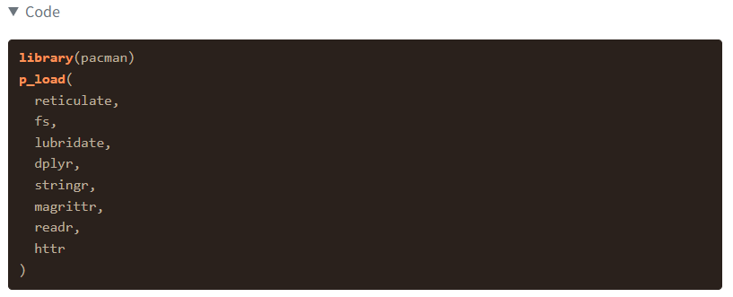

# Link external R code to the documentation

documentation

Quarto

How to link your repo code automatically to the github page

Author

Frank Aragona

Published

November 24, 2026

The code in this website is automatically linked to the code in the repository. This lets us update the code and not need to copy and paste any new changes to the documentation/github page

To do this, open your *external* R script in your repo. In this case we’re using `lineages_public_repo.R`. Now wrap the chunks of code you want to link with comments like this, `## ---- libraries` and `## ---- stop`:

``` r
## ---- libraries
library(pacman)
p_load(
  reticulate,
  fs,
  lubridate,
  dplyr,
  stringr,
  magrittr,
  readr,
  httr
)
## ---- stop
```

The `## ---- libraries` signals the beginning of a chunk. the `## ---- stop` signals the end of a chunk.

\

Now you can call this chunk in your *github page/quarto document* like this:

Scan the external R script for code chunks:

```` markdown
```{r setup}
#| echo: false
knitr::read_chunk(file.path(getwd(),"lineages_public_repo.R"))
```
````

\

Call the code chunk you want in the `{r}` header within the chunk. like this `{r libraries}`:

```` markdown
```{r libraries}

```
````

\

And now the document will output any code in that code chunk and can also execute that code chunk if you want. Here’s what the output will look like in this case:



Back to top
