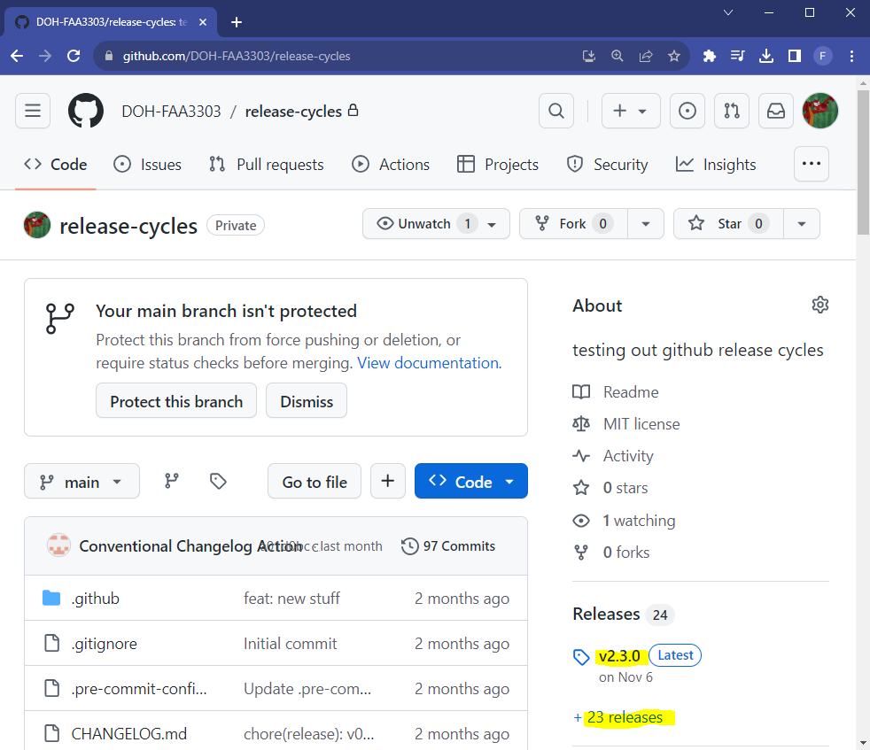
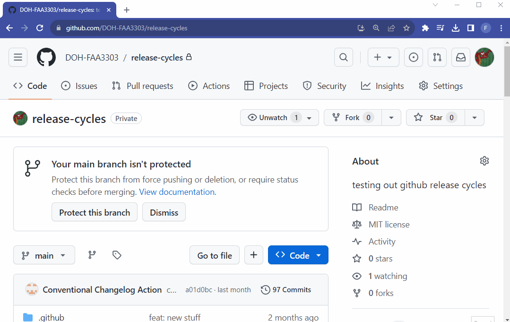
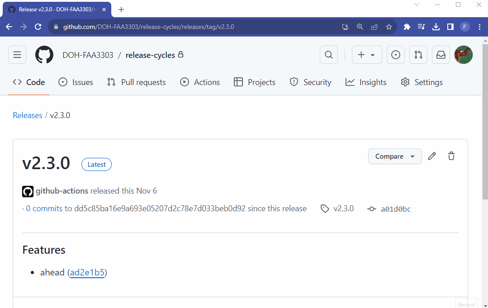
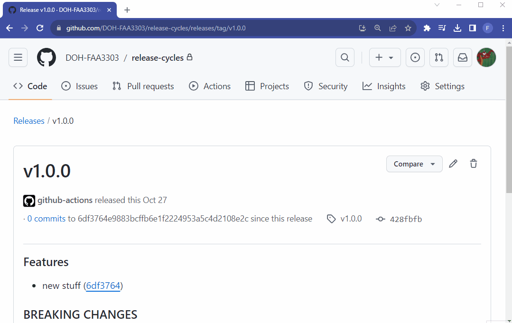
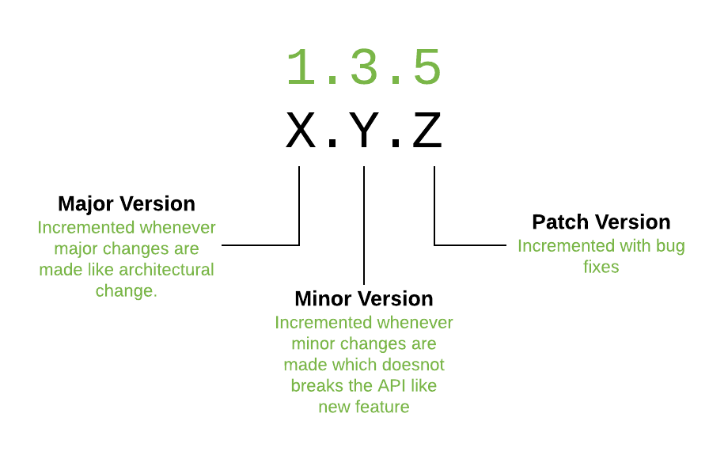
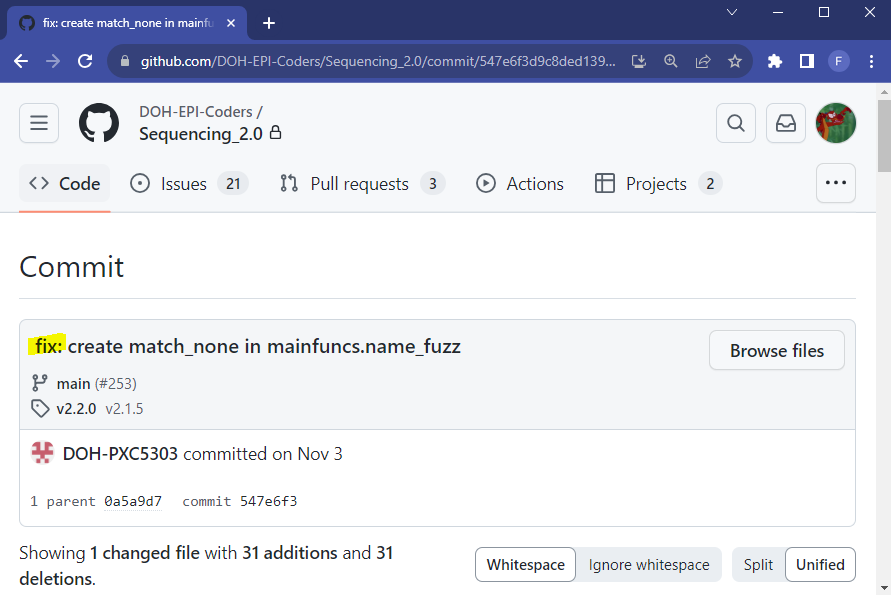
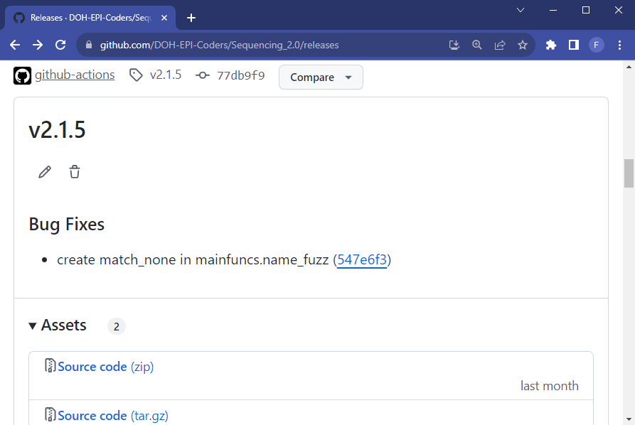

# Release Cycles

Utilizing and automating Github Releases in your repo

Author

Affiliations

Frank Aragona [](mailto:frank.aragona@doh.wa.gov)

Washington Department of Health

Data Integration/Quality Assurance

Published

Friday, the 1st of September, 2023

Modified

Tuesday, the 24th of November, 2026

## **Summary**

- Github Releases
- Helps devs and end users
- Changelogs and semantic versioning
- Automate the release process

\

## Github Releases

In the right panel of your Github repo there is a section labeled Releases. Here you can create or find a version of your repo’s code base. Each version comes with a changelog, tags, and downloadable source code. Developers and end-users may find this helpful to navigate to what the repo contained at specific release versions and have the source code available for download at the specific version.



\

If you click on the releases you can see different release tags/versions. Each comes with a changelog, tag, git hash number, and zip files to download the repo *at the time the specific version was released*. This means you can automatically save repo snapshots and backups whenever your project cycle is released.



\

you can flip through different releases and tags here



\

You can click on a tag and it will take you to the repo *at the time the specific version was released*



## Semantic Versioning

Software projects often label their releases using semantic versioning. It looks like this, where the software version numbers all have a definition:

[](https://www.softwarecraftsperson.com/2020/12/06/semantic-versioning-semver-introduction/)

https://www.softwarecraftsperson.com/2020/12/06/semantic-versioning-semver-introduction/

## Conventional Commits

To create the release cycle in your repo you may want to use Conventional Commits.

Conventional Commits are a way to format and standardize your commit messages, which can be used to then automate the repo’s release cycle. For example, one conventional naming method is to label any commit associated with a new feature as `feat:` plus a commit message.

- The word `feat:` can trigger a Github Action to add that commit to your changelog under the **Features** header,
- and it will up-version the minor release version number.
- So if you are on release 1.0.0, a new `feat` will up-version the cycle to 1.1.0
- Commit titles that start with the word `fix:` as in a bug fix will up-version the patch number of the, i.e. 1.0.0 to 1.0.1

# Conventional Commits 1.0.0

## Summary

The Conventional Commits specification is a lightweight convention on top of commit messages. It provides an easy set of rules for creating an explicit commit history; which makes it easier to write automated tools on top of. This convention dovetails with [SemVer](http://semver.org), by describing the features, fixes, and breaking changes made in commit messages.

The commit message should be structured as follows:

------------------------------------------------------------------------

    <type>[optional scope]: <description>

    [optional body]

    [optional footer(s)]

------------------------------------------------------------------------

The commit contains the following structural elements, to communicate intent to the consumers of your library:

1.  **fix:** a commit of the *type* `fix` patches a bug in your codebase (this correlates with [`PATCH`](http://semver.org/#summary) in Semantic Versioning).
2.  **feat:** a commit of the *type* `feat` introduces a new feature to the codebase (this correlates with [`MINOR`](http://semver.org/#summary) in Semantic Versioning).
3.  **BREAKING CHANGE:** a commit that has a footer `BREAKING CHANGE:`, or appends a `!` after the type/scope, introduces a breaking API change (correlating with [`MAJOR`](http://semver.org/#summary) in Semantic Versioning). A BREAKING CHANGE can be part of commits of any *type*.
4.  *types* other than `fix:` and `feat:` are allowed, for example [@commitlint/config-conventional](https://github.com/conventional-changelog/commitlint/tree/master/%40commitlint/config-conventional) (based on the [Angular convention](https://github.com/angular/angular/blob/22b96b9/CONTRIBUTING.md#-commit-message-guidelines)) recommends `build:`, `chore:`, `ci:`, `docs:`, `style:`, `refactor:`, `perf:`, `test:`, and others.
5.  *footers* other than `BREAKING CHANGE: <description>` may be provided and follow a convention similar to [git trailer format](https://git-scm.com/docs/git-interpret-trailers).

Additional types are not mandated by the Conventional Commits specification, and have no implicit effect in Semantic Versioning (unless they include a BREAKING CHANGE). A scope may be provided to a commit’s type, to provide additional contextual information and is contained within parenthesis, e.g., `feat(parser): add ability to parse arrays`.

## Examples

### Commit message with description and breaking change footer

    feat: allow provided config object to extend other configs

    BREAKING CHANGE: `extends` key in config file is now used for extending other config files

### Commit message with `!` to draw attention to breaking change

    feat!: send an email to the customer when a product is shipped

### Commit message with scope and `!` to draw attention to breaking change

    feat(api)!: send an email to the customer when a product is shipped

### Commit message with both `!` and BREAKING CHANGE footer

    feat!: drop support for Node 6

    BREAKING CHANGE: use JavaScript features not available in Node 6.

### Commit message with no body

    docs: correct spelling of CHANGELOG

### Commit message with scope

    feat(lang): add Polish language

### Commit message with multi-paragraph body and multiple footers

    fix: prevent racing of requests

    Introduce a request id and a reference to latest request. Dismiss
    incoming responses other than from latest request.

    Remove timeouts which were used to mitigate the racing issue but are
    obsolete now.

    Reviewed-by: Z
    Refs: #123

## Specification

The key words “MUST”, “MUST NOT”, “REQUIRED”, “SHALL”, “SHALL NOT”, “SHOULD”, “SHOULD NOT”, “RECOMMENDED”, “MAY”, and “OPTIONAL” in this document are to be interpreted as described in [RFC 2119](https://www.ietf.org/rfc/rfc2119.txt).

1.  Commits MUST be prefixed with a type, which consists of a noun, `feat`, `fix`, etc., followed by the OPTIONAL scope, OPTIONAL `!`, and REQUIRED terminal colon and space.
2.  The type `feat` MUST be used when a commit adds a new feature to your application or library.
3.  The type `fix` MUST be used when a commit represents a bug fix for your application.
4.  A scope MAY be provided after a type. A scope MUST consist of a noun describing a section of the codebase surrounded by parenthesis, e.g., `fix(parser):`
5.  A description MUST immediately follow the colon and space after the type/scope prefix. The description is a short summary of the code changes, e.g., *fix: array parsing issue when multiple spaces were contained in string*.
6.  A longer commit body MAY be provided after the short description, providing additional contextual information about the code changes. The body MUST begin one blank line after the description.
7.  A commit body is free-form and MAY consist of any number of newline separated paragraphs.
8.  One or more footers MAY be provided one blank line after the body. Each footer MUST consist of a word token, followed by either a `:<space>` or `<space>#` separator, followed by a string value (this is inspired by the [git trailer convention](https://git-scm.com/docs/git-interpret-trailers)).
9.  A footer’s token MUST use `-` in place of whitespace characters, e.g., `Acked-by` (this helps differentiate the footer section from a multi-paragraph body). An exception is made for `BREAKING CHANGE`, which MAY also be used as a token.
10. A footer’s value MAY contain spaces and newlines, and parsing MUST terminate when the next valid footer token/separator pair is observed.
11. Breaking changes MUST be indicated in the type/scope prefix of a commit, or as an entry in the footer.
12. If included as a footer, a breaking change MUST consist of the uppercase text BREAKING CHANGE, followed by a colon, space, and description, e.g., *BREAKING CHANGE: environment variables now take precedence over config files*.
13. If included in the type/scope prefix, breaking changes MUST be indicated by a `!` immediately before the `:`. If `!` is used, `BREAKING CHANGE:` MAY be omitted from the footer section, and the commit description SHALL be used to describe the breaking change.
14. Types other than `feat` and `fix` MAY be used in your commit messages, e.g., *docs: update ref docs.*
15. The units of information that make up Conventional Commits MUST NOT be treated as case-sensitive by implementors, with the exception of BREAKING CHANGE which MUST be uppercase.
16. BREAKING-CHANGE MUST be synonymous with BREAKING CHANGE, when used as a token in a footer.

## Why Use Conventional Commits

- Automatically generating CHANGELOGs.
- Automatically determining a semantic version bump (based on the types of commits landed).
- Communicating the nature of changes to teammates, the public, and other stakeholders.
- Triggering build and publish processes.
- Making it easier for people to contribute to your projects, by allowing them to explore a more structured commit history.

## FAQ

### How should I deal with commit messages in the initial development phase?

We recommend that you proceed as if you’ve already released the product. Typically *somebody*, even if it’s your fellow software developers, is using your software. They’ll want to know what’s fixed, what breaks etc.

### Are the types in the commit title uppercase or lowercase?

Any casing may be used, but it’s best to be consistent.

### What do I do if the commit conforms to more than one of the commit types?

Go back and make multiple commits whenever possible. Part of the benefit of Conventional Commits is its ability to drive us to make more organized commits and PRs.

### Doesn’t this discourage rapid development and fast iteration?

It discourages moving fast in a disorganized way. It helps you be able to move fast long term across multiple projects with varied contributors.

### Might Conventional Commits lead developers to limit the type of commits they make because they’ll be thinking in the types provided?

Conventional Commits encourages us to make more of certain types of commits such as fixes. Other than that, the flexibility of Conventional Commits allows your team to come up with their own types and change those types over time.

### How does this relate to SemVer?

`fix` type commits should be translated to `PATCH` releases. `feat` type commits should be translated to `MINOR` releases. Commits with `BREAKING CHANGE` in the commits, regardless of type, should be translated to `MAJOR` releases.

### How should I version my extensions to the Conventional Commits Specification, e.g. `@jameswomack/conventional-commit-spec`?

We recommend using SemVer to release your own extensions to this specification (and encourage you to make these extensions!)

### What do I do if I accidentally use the wrong commit type?

#### When you used a type that’s of the spec but not the correct type, e.g. `fix` instead of `feat`

Prior to merging or releasing the mistake, we recommend using `git rebase -i` to edit the commit history. After release, the cleanup will be different according to what tools and processes you use.

#### When you used a type *not* of the spec, e.g. `feet` instead of `feat`

In a worst case scenario, it’s not the end of the world if a commit lands that does not meet the Conventional Commits specification. It simply means that commit will be missed by tools that are based on the spec.

### Do all my contributors need to use the Conventional Commits specification?

No! If you use a squash based workflow on Git lead maintainers can clean up the commit messages as they’re merged—adding no workload to casual committers. A common workflow for this is to have your git system automatically squash commits from a pull request and present a form for the lead maintainer to enter the proper git commit message for the merge.

### How does Conventional Commits handle revert commits?

Reverting code can be complicated: are you reverting multiple commits? if you revert a feature, should the next release instead be a patch?

Conventional Commits does not make an explicit effort to define revert behavior. Instead we leave it to tooling authors to use the flexibility of *types* and *footers* to develop their logic for handling reverts.

One recommendation is to use the `revert` type, and a footer that references the commit SHAs that are being reverted:

    revert: let us never again speak of the noodle incident

    Refs: 676104e, a215868

## Automating The Release Cycle

You should consider automating your release cycle so that your project cycle is consistent and predictable. There are many different ways to approach this.

Some repos have semi-automatic cycles where there is some manual component of releasing their software, whereas others are fully automated. Manual releases can work too for some scenarios.

### Github Action for auto releases

I recommend first creating a test repo for this. In the repo, create a Github Action workflow called `changelog.yml`. You can copy the full file below:

``` yaml
name: Changelog
on:
  push:
    branches:
      - main

jobs:
  changelog:
    runs-on: ubuntu-latest
    
    permissions:
      # write permission is required to create a github release
      contents: write

    steps:
      - uses: actions/checkout@v2

      - name: Conventional Changelog Action
        id: changelog
        uses: TriPSs/conventional-changelog-action@v3
        with:
          github-token: ${{ secrets.github_token }}
          create-summary: true

      - name: Create Release
        uses: actions/create-release@v1
        if: ${{ steps.changelog.outputs.skipped == 'false' }}
        env:
          GITHUB_TOKEN: ${{ secrets.github_token }}
        with:
          prerelease: false
          tag_name: ${{ steps.changelog.outputs.tag }}
          release_name: ${{ steps.changelog.outputs.tag }}
          body: ${{ steps.changelog.outputs.clean_changelog }}
```

## 

This workflow will be triggered everytime a branch is merged to main. If that branch has [conventinal commit messages](@sec-cc) the commits will be summarized in the changelog. See an example workflow below:





\

If I make a branch off of main, I can add features, bug fixes, and more. If I used conventional commit messages in the title (i.e. `feat: message`, `fix: message`) the Github Action workflow will detect the trigger word in the title and divide the commit accordingly in the changelog. Notice how the commit title message gets output automatically into the changelog under the header **Bug Fixes** and the commit + commit hash number are generated.

A new version will be released, and since this was just a bug fix the version number went from `v2.1.4` to `v2.1.5` since bug fixes only up-version the patch numbers

## 

The first step uses the Github Action `TriPSs/conventional-changelog-action@v3` which will scan your

``` yaml
steps:
  - uses: actions/checkout@v2

  - name: Conventional Changelog Action
    id: changelog
    uses: TriPSs/conventional-changelog-action@v3
    with:
      github-token: ${{ secrets.github_token }}
      create-summary: true
```

The second step uses the Github Action `actions/create-release@v1` which will create git tags with the version number and a changelog with downloadable source code

``` yaml
- name: Create Release
  uses: actions/create-release@v1
  if: ${{ steps.changelog.outputs.skipped == 'false' }}
  env:
    GITHUB_TOKEN: ${{ secrets.github_token }}
  with:
    prerelease: false
    tag_name: ${{ steps.changelog.outputs.tag }}
    release_name: ${{ steps.changelog.outputs.tag }}
    body: ${{ steps.changelog.outputs.clean_changelog }}
```

## Step by Step Instructions

1.  Make a test repo in Github, then clone it locally
2.  Make a folder in the root of the repo named `.github`
3.  In the `.github` folder make another folder named `workflows` . the `.github/workflows` folder needs to be spelled the same and in the in exact same place for a github action to work.
4.  In the `workflows` folder make a file called `changelog.yml` and paste code below in it:

``` yaml
name: Changelog
on:
  push:
    branches:
      - main

jobs:
  changelog:
    runs-on: ubuntu-latest
    
    permissions:
      # write permission is required to create a github release
      contents: write

    steps:
      - uses: actions/checkout@v2

      - name: Conventional Changelog Action
        id: changelog
        uses: TriPSs/conventional-changelog-action@v3
        with:
          github-token: ${{ secrets.github_token }}
          create-summary: true

      - name: Create Release
        uses: actions/create-release@v1
        if: ${{ steps.changelog.outputs.skipped == 'false' }}
        env:
          GITHUB_TOKEN: ${{ secrets.github_token }}
        with:
          prerelease: false
          tag_name: ${{ steps.changelog.outputs.tag }}
          release_name: ${{ steps.changelog.outputs.tag }}
          body: ${{ steps.changelog.outputs.clean_changelog }}
```

> **NOTE:**
>
> Now when you commit something to the repo and have a convential commit message it will trigger the Github Action to make a changelog.
>
> For example, if you make a commit with a bug fix and in the commit title you write the word `fix:` like this - `fix: this commit is a bugfix` - the action will get triggered to make a new changelog with the commit and bump up the minor version (like from v1.0.0 to v1.0.1)

**This is great, but if you do not write a conventional commit message it will not work**. Step 5 has instructions on how to make sure everyone on your team writes conventional commits. It uses a pre-commit hook, which will prevent any commit that does not have a conventional commit message from being pushed to the repo.

For example, this commit message will error out and not be pushed to the repo - `this commit is a feature`. But this commit message will work - `feat: this commit is a feature`

5.  (Optional, but recommended) Make a pre-commit hook

    - Open a Windows Command Prompt
    - [Install pre-commit](https://pre-commit.com/#intro) with the code below

    ``` default
    pip install pre-commit
    ```

    - Check that pre-commit is working by running the code below. If you get an error message with this you may need to install `pip`

    ``` default
    pre-commit --version
    ```

    - In the **root** of you repo, make a file called `.pre-commit-config.yaml` and put the following code in it (note the `.` is necessary in the file name):

    ``` yaml
    repos:
    - repo: https://github.com/compilerla/conventional-pre-commit
      rev: v2.4.0
      hooks:
        - id: conventional-pre-commit
          stages: [commit-msg]
          args: []
      # args is optional: list of Conventional Commits types to allow e.g. [feat, fix, ci, chore, test]
    ```

    - Last, in the Windows Command Prompt, run this:

    ``` bash
    pre-commit install --hook-type commit-msg
    ```

Now you will be required to use conventional commit messages when pushing new code to the repo.

Here’s a common guide:

[TABLE]

**NOTE**: breaking changes need to be written like this:


## Resources

These videos are excellent summaries of how to use Github Releases and semantic versioning

# An error occurred.

Unable to execute JavaScript.

# An error occurred.

Unable to execute JavaScript.

Back to top
