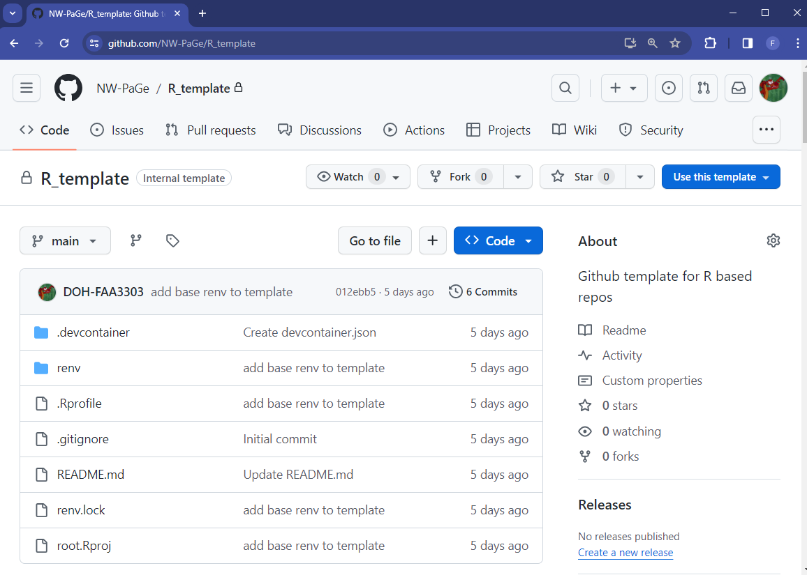

# Templates

Github and Quarto templates for repos and document styles

Author

Affiliations

Frank Aragona 

Washington Department of Health

Data Integration/Quality Assurance

Published

Friday, the 1st of September, 2023

Modified

Tuesday, the 24th of November, 2026

## [R Github Template](https://github.com/NW-PaGe/R_template)

This is a Github repo template for R projects. It has `renv` set up and a `.devcontainer` for reproducibility

|  |  |
|----|----|
| Select `Use Template > NW-PaGe/R_template` when creating a new repo in the NW-PaGe org. The template comes with a pre-filled `README.md` file that you can edit to your own needs. It’s recommended to leave the `.devconainter` folder in this repo. It serves as instructions to install all the software and R packages needed to reproduce the repos code using a Github Codespace. See the `README.md` for more information. |  |

## [Purpledoc Quarto Template](https://github.com/coe-test-org/purpledoc)

This is a Quarto template that contains the style and images used in this site

[TABLE]

Back to top
